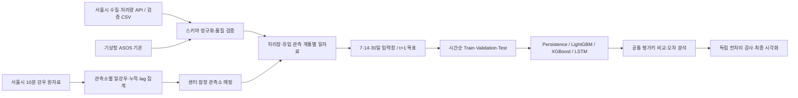
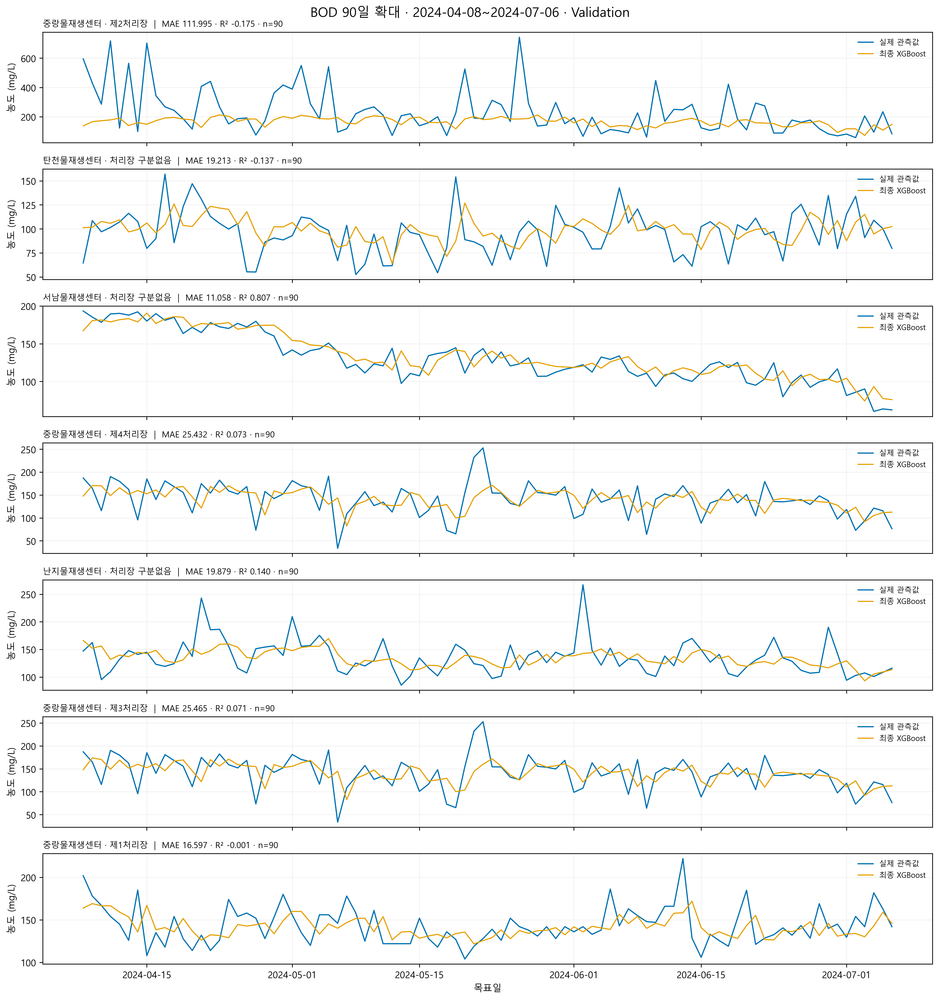
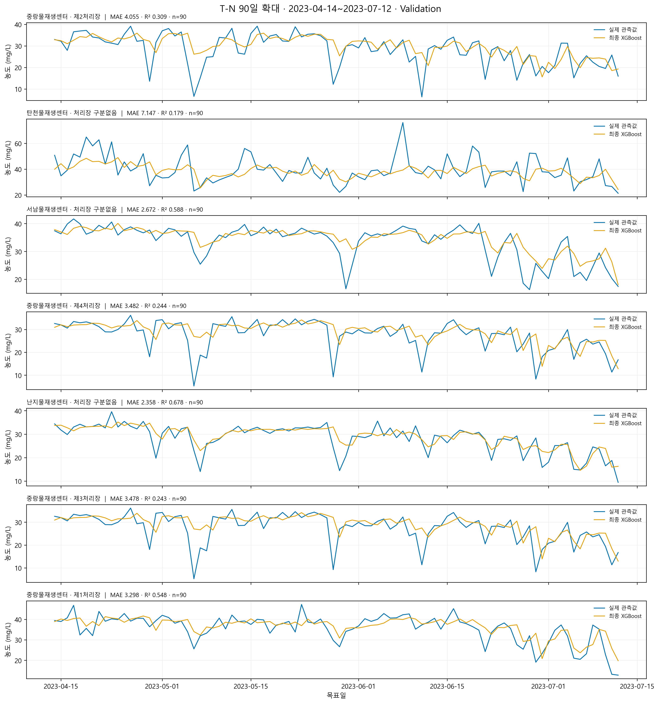
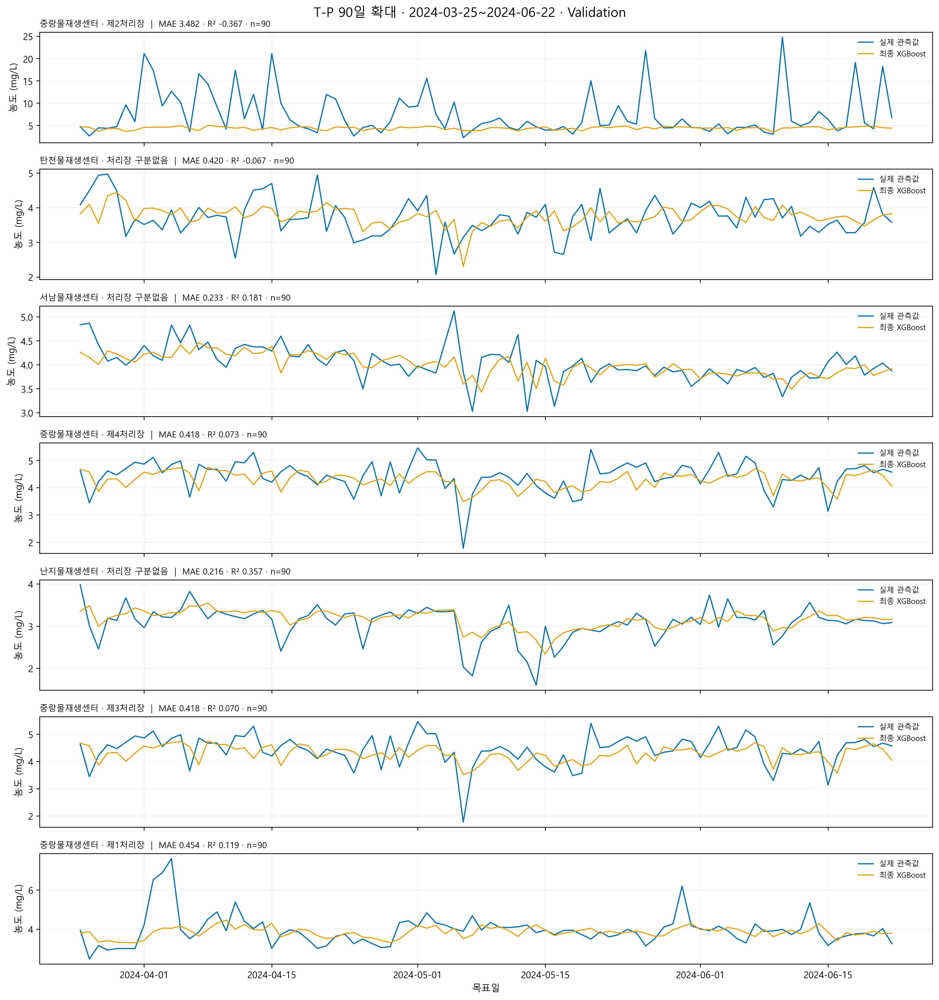
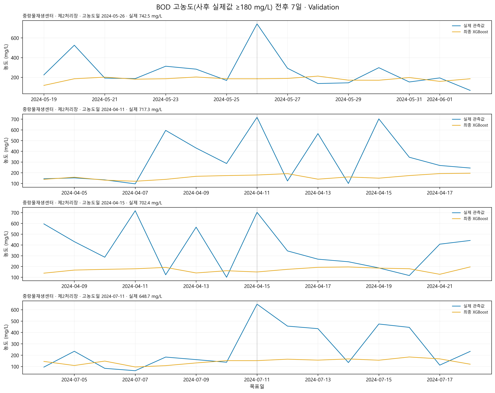
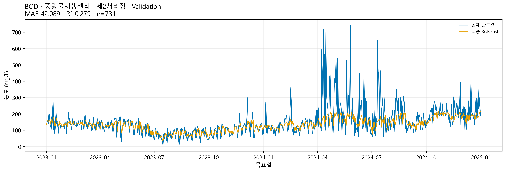

# 서울시 물재생센터 유입수질 예측

서울시 4개 물재생센터의 처리장·유입수 관측 계통을 대상으로 **과거 30일 수질과 기상 정보를 이용해 다음 날 BOD·T-N·T-P를 예측**한 시계열 머신러닝 프로젝트입니다. 데이터 수집부터 품질 검증, 모델 비교, 독립 전처리 감사와 실패 구간 분석까지 하나의 재현 가능한 파이프라인으로 구성했습니다.

> 이 프로젝트는 연구·포트폴리오 목적의 오프라인 예측 시스템입니다. 현재 운영 중인 실시간 서비스가 아닙니다.

## 1. 문제 정의와 목표

하수 유입수질은 강우, 계절, 처리장 운영과 유입 특성에 따라 변동합니다. 특히 고농도 급등은 다음 날 운전 의사결정에 중요하지만 단순 전일값이나 평균적인 회귀 모델이 놓치기 쉽습니다.

- 처리장·유입 관측 계통별 다음 날(`t+1`) BOD·T-N·T-P 농도 예측
- LightGBM·XGBoost·LSTM을 동일 시간 분할과 평가 표본에서 비교
- 서울시 강우, 계절·요일, SS 피처의 추가 효과 검증
- 계통별·계절별·고농도 구간의 실패 원인 분석
- 원본 일부를 독립 재계산해 AI 작성 전처리 코드의 신뢰성 감사

## 2. 기술 스택과 개발 환경

| 구분 | 기술 |
|---|---|
| 언어·데이터 | Python 3.13.5, pandas, NumPy, PyArrow |
| 수집 | requests, python-dotenv, 재시도·페이지네이션·로컬 캐시 |
| 모델 | LightGBM, XGBoost, PyTorch LSTM |
| 평가 | scikit-learn, 시간순 Train/Validation/Test 분할 |
| 시각화 | matplotlib, 300dpi PNG |
| 품질·테스트 | pytest, SHA-256 원본 인벤토리, 독립 표본 재계산 |

정확한 패키지 버전은 [`requirements.txt`](requirements.txt)에 고정했습니다.

## 3. 데이터 파이프라인



### 데이터 출처와 범위

| 자료 | 출처·서비스 | 기간·규모 |
|---|---|---|
| 유입수질 | 서울시 `ViewQowRep` 및 대조 CSV | 2016-01-01~2026-09-30, 원본 74,917행 중 유입수 28,828행 |
| 처리량 | 서울시 `ViewTreQty` 및 대조 CSV | 원본 48,771행, 정확키 결합 18,443행 |
| 기온 | 기상청 ASOS 일자료 | 서울 108 중심, 수질 28,828행에 결합 |
| 강우 | 서울시 강우 관측망 10분 자료 | 관측 파일 944개, 38,322,021행, 관측소 69개 |

원본 CSV, API 캐시, Parquet·NPZ, 모델 가중치는 저장소에 포함하지 않습니다. CSV는 API 결과 검증용 참고 원본이며 수질·처리량의 최종 수집 구조는 API 기반으로 유지했습니다.

## 4. 전처리와 데이터 품질

- `계통구분=유입수`만 사용하고 방류수질을 목표에서 제외했습니다.
- `TP`를 분석 표기 `T-P`와 매핑하고 원래 단위(mg/L)를 보존했습니다.
- 결측·0·이상치를 임의 삭제·보간하지 않고 원본값과 품질 상태를 유지했습니다.
- 서울시 강우는 10분 자료 144개가 모두 존재하는 날을 완전 관측일로 판정했습니다.
- 강우 누적값에 미확인 결측이 포함되면 누적값도 `NaN`으로 유지했습니다.
- 처리량은 정확히 대응하는 계통만 결합했습니다. `1차+2차`는 공식 유입유량이 아닌 검증 가설입니다.
- 모든 lag·rolling은 계통별로 `shift`한 뒤 계산해 미래 정보를 차단했습니다.

### 11개 원본 계통 → 학습 10개 → 평가 7개

원본 유입수질은 11개 관측 계통입니다. 연속 30일 입력창과 목표값을 만들 수 있는 계통은 Train에서 10개였고, Validation/Test 기간까지 충분한 연속 관측이 남은 계통은 7개였습니다.

- 중랑: 제1·제2·제3·제4처리장
- 난지·탄천·서남: 처리장 구분없음 각 1개

처리장 구분없음은 공식 센터 대표값으로 재해석하거나 다른 처리장과 평균하지 않고 독립 계통으로 유지했습니다.

## 5. 예측 설계

- 입력: 해당 계통의 목표일 직전 30일 수질·기온·서울시 강우 피처
- 목표: 다음 날(`t+1`) BOD·T-N·T-P
- Train: 2016~2022년 / Validation: 2023~2024년 / Test: 2025-01-01~2026-09-30
- 분할 기준: `target_date`, 모델 선택 기준: Validation MAE
- 평가: MAE·RMSE·R², Persistence 대비 개선율, 계통별·고농도 슬라이스

Test는 프로젝트 과정에서 반복적으로 확인했으므로 완전히 미사용된 독립 홀드아웃으로 주장하지 않습니다. 모델과 달력 피처 선택은 Validation 결과를 기준으로 수행했습니다.

## 6. LightGBM·XGBoost·LSTM 비교

동일한 B 구성(과거 수질+ASOS 기온), 30일 입력과 공통 평가 표본에서 비교한 Validation MAE입니다.

| 목표 | Persistence | LightGBM | XGBoost | LSTM |
|---|---:|---:|---:|---:|
| BOD | 29.1064 | 23.9571 | **23.7582** | 24.6479 |
| T-N | 4.1024 | 3.3801 | **3.3528** | 3.3975 |
| T-P | 0.6519 | **0.5294** | 0.5303 | 0.5368 |

세 알고리즘의 차이는 크지 않았지만 XGBoost가 BOD·T-N에서 가장 낮았고, 목표별 강우·달력 실험에서도 안정적이어서 최종 알고리즘으로 선택했습니다.

## 7. 최종 모델과 성능

| 목표 | 최종 입력 구성 | Validation MAE | Persistence 대비 개선 | Test MAE¹ | Test R²¹ |
|---|---|---:|---:|---:|---:|
| BOD | C/30일 + 계절·요일 | **23.2784** | **20.02%** | 22.4176 | 0.6028 |
| T-N | E/30일 + 요일 | **3.1977** | **22.05%** | 3.3942 | 0.5981 |
| T-P | C/30일 + 요일 | **0.5093** | **21.87%** | 0.5294 | 0.4027 |

¹ Test는 반복적으로 확인된 참고 성능입니다.

- C: 과거 수질 + ASOS 기온 + 서울시 일강우량
- E: C + 강우 1~3일 lag + 3·7일 누적강우량 + 일 최대 1시간 강우량

수치는 [`최종 시각화 성능표`](reports/final_model_visualization_metrics_2026-11-14.csv)의 동일 평가 키에서 재확인했습니다.

## 8. 실제값과 예측값

확대 기간은 모델 오차나 Test가 아니라 **Validation 실제값의 90일 총 절대 변화량**으로 선정했습니다. 파란색은 실제 관측값, 주황색은 최종 XGBoost 예측입니다.

### BOD



### T-N



### T-P



## 9. 강우·계절·요일·SS 피처 실험

- **서울시 강우:** XGBoost Validation MAE를 BOD 1.24%, T-N 4.40%, T-P 3.31% 개선했습니다. 관측소는 공식 하수처리구역 대표가 아닌 잠정 매핑입니다.
- **계절·요일:** 계절 단독은 효과가 없었으나 BOD는 계절+요일, T-N·T-P는 요일 추가 시 소폭 개선됐습니다.
- **SS:** XGBoost T-N은 0.31% 개선됐지만 BOD·T-P는 악화해 최종 공통 피처로 채택하지 않았습니다.
- **BOD 2배 가중:** 전체 성능 악화는 제한했지만 사전 목표인 고농도 MAE 10% 개선에 미달했습니다.

## 10. 고농도 BOD와 실패 패턴

Train BOD 90백분위인 180mg/L 이상을 사후 고농도 기준으로 사용했습니다. Validation에서 최종 XGBoost의 고농도 MAE는 55.5447mg/L, 과소예측률은 91.80%였습니다. 이는 예측 시점에 고농도 여부를 알고 있다는 뜻이 아닙니다.



특히 중랑 제2처리장은 급격한 BOD 변동과 고농도 사례가 집중된 취약 계통입니다.



## 11. 독립 전처리 감사

기존 전처리 함수를 호출하지 않는 별도 감사 경로로 검증했습니다.

| 감사 항목 | 결과 |
|---|---:|
| 원본 파일 SHA-256 기준선 | CSV 947개, 약 1.24GB |
| 강우 원시 관측자료 계보 | 38,322,021행 |
| 수질 원본-가공 전수 대조 | 28,828/28,828행 일치 |
| 강우 독립 재계산 | 650/650 관측소-일 일치 |
| 30일 모델 입력 독립 복원 | 19,584/19,584개 값 일치 |
| 계통 혼합·미래 날짜·분할 오류 | 0건 |
| 자동 테스트 | 107개 통과 |

650개 관측소-일과 128개 입력창은 고정 시드 층화 표본 감사입니다. 전체 강우 원시 행을 두 번째 구현으로 전수 재집계한 것은 아니며 원본 센서의 계측 정확도까지 보증하지 않습니다. 과거 해시가 없던 파일의 현재 SHA-256은 향후 변경 검사용 기준선이지 과거 불변의 증거가 아닙니다.

자세한 내용은 [`전처리 독립 감사 보고서`](reports/preprocessing_independent_audit_2026-11-14.md)를 참고하세요.

## 12. 실행과 재현

### 환경 설정

```powershell
python -m venv .venv
.venv\Scripts\Activate.ps1
python -m pip install -r requirements.txt
Copy-Item .env.example .env
```

`.env`에는 본인이 발급받은 키를 설정하며 저장소에 커밋하지 않습니다.

```dotenv
SEOUL_API_KEY=...
DATA_GO_KR_API_KEY=...
```

### 테스트와 주요 단계

원본은 Git에서 제외되므로 재현 시 `data/external/`에 검증 CSV와 서울시 강우 자료가 필요합니다.

```powershell
python -m pytest -q
python scripts/collect_asos_daily.py
python scripts/process_seoul_rainfall.py       # 대용량 강우 표준화
python scripts/build_training_dataset.py

# 공통 모델 단일 실험 예시
python scripts/train_xgboost_comparison.py --train-one --config C --window 30 --target bod_mg_l

# 최종 달력 피처 실험·시각화·독립 감사
python scripts/train_calendar_weighted_xgboost.py
python scripts/visualize_simplified_final_predictions.py
python scripts/run_preprocessing_audit.py
```

수집·학습 결과는 `data/processed/`, `results/`에 저장되며 Git에서 제외됩니다. 전체 실행은 데이터 용량과 CPU/GPU 환경에 따라 오래 걸릴 수 있습니다.

## 13. 프로젝트 구조

```text
├─ configs/                 # 관측소·수집 설정
├─ docs/                    # 설계·데이터 사전·포트폴리오 이미지
├─ reports/                 # 핵심 품질·모델·감사 결과표와 보고서
├─ scripts/                 # 수집·전처리·학습·평가 진입점
├─ src/
│  ├─ audit/                # 기존 구현과 독립된 감사 로직
│  ├─ data/                 # API, 캐시, 서울시 강우 처리
│  ├─ evaluation/           # 평가키·시각화 검증
│  ├─ models/               # LightGBM·XGBoost·LSTM
│  └─ preprocessing/        # 스키마·결합·윈도 생성
└─ tests/                   # 누수·계통 혼합·모델·감사 회귀 테스트
```

## 14. 한계와 향후 개선

| 한계 | 의미와 개선 방향 |
|---|---|
| BOD·T-P 고농도 과소예측 | 평균 회귀 경향이 급등을 축소함. 위험 분류, quantile/비대칭 손실, 예측구간 검토 |
| 계통별 성능 차이 | 중랑 제2·탄천 일부 패턴을 충분히 설명하지 못함. 표본이 충분한 계통별 모델 비교 |
| 잠정 강우 관측소 매핑 | 인접 관측소가 하수처리구역 전체를 대표한다고 단정할 수 없음. GIS 기반 검증 필요 |
| 수질·기상 공개 시점 미확인 | 당일 실측 입력이 예측 발행 시각에 가용한지 미확인. 운영 전 공개 지연 계약 검증 필요 |
| 처리량 정의 미확정 | 1차·2차 합계를 실제 유입유량으로 볼 공식 근거 부족. 측정 경계·비중복성 확인 필요 |
| 반복 확인된 Test | 완전히 잠긴 최종 홀드아웃이 아님. 향후 미사용 기간 또는 rolling-origin 평가 필요 |
| 오프라인 프로젝트 | 자동 배포·모니터링·재학습·알림이 없음. 운영화 시 데이터 지연·드리프트 감시 필요 |

## 15. 주요 문서

- [데이터 품질 보고서](reports/data_quality_report.md)
- [센터·계통 통합 규칙](docs/integration_rules.md)
- [학습 데이터셋 보고서](reports/training_dataset_report.md)
- [3종 모델 비교 보고서](reports/xgboost_lstm_comparison_report.md)
- [최종 성능 통합 보고서](reports/final_model_integration_report_2026-11-13.md)
- [최종 시각화 보고서](reports/final_model_visualization_report_2026-11-14.md)
- [전처리 독립 감사 보고서](reports/preprocessing_independent_audit_2026-11-14.md)

## 보안 및 저장소 정책

`.env`, API 캐시, 원본 CSV, Parquet·NPZ, 모델 가중치와 전체 실행 결과는 `.gitignore`로 제외합니다. 저장소에는 코드, 테스트, 설정 예시, 핵심 요약 보고서와 대표 이미지 파일만 포함합니다.
