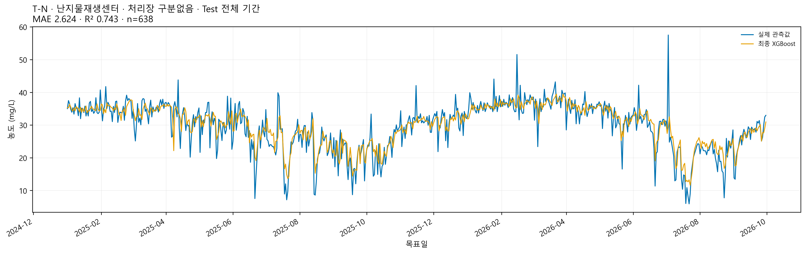
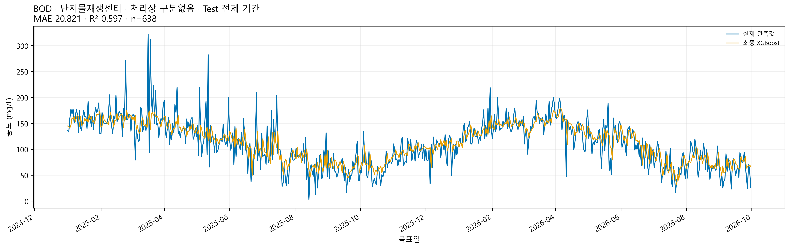
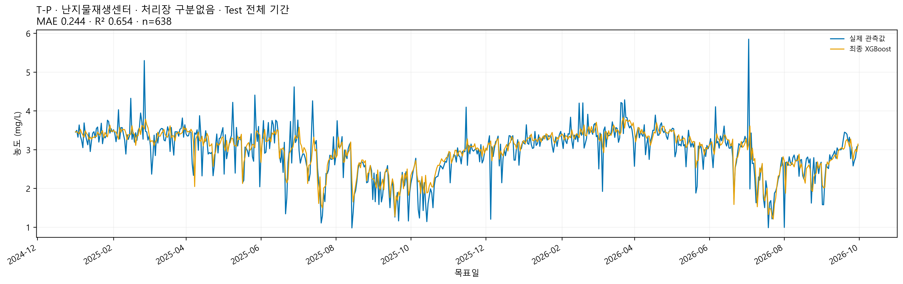
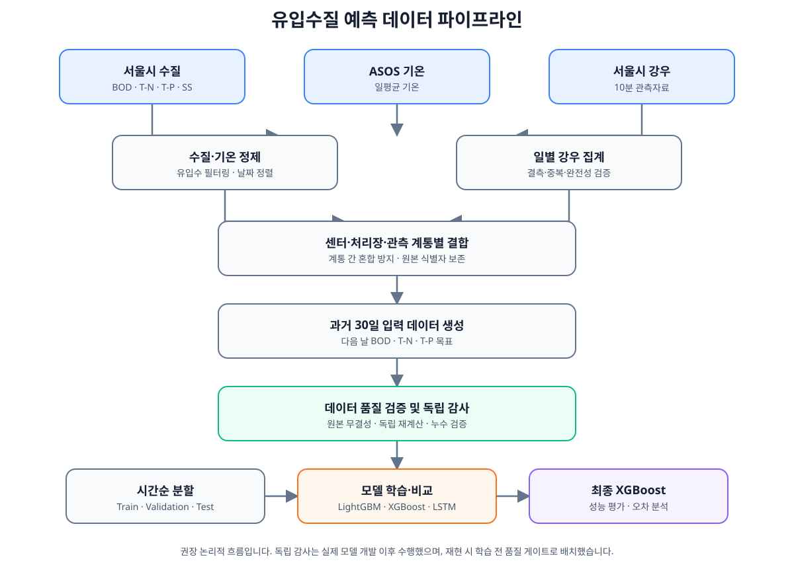

# 서울시 물재생센터 유입수질 예측

과거 30일의 수질·기온·강우 자료로 서울시 4개 물재생센터의 **다음 날 BOD·T-N·T-P를 예측**한 시계열 머신러닝 프로젝트입니다. 대규모 강우 자료의 품질을 검증하고 LightGBM·XGBoost·LSTM을 공정하게 비교해 목표별 XGBoost 모델을 선정했습니다.

| 핵심 성과 | 결과 |
|---|---|
| 최종 모델 | 목표별 30일 입력 기반 통합 XGBoost |
| Validation 개선 | Persistence 대비 MAE BOD **20.02%**, T-N **22.05%**, T-P **21.87%** 개선 |
| 데이터 처리 | 서울시 10분 강우 **38,322,021행**, 유입수질 **28,828행** |
| 신뢰성 검증 | 강우 650 관측소-일·모델 입력 19,584개 값 독립 복원, 자동 테스트 107개 통과 |

> 연구·취업 포트폴리오 목적의 오프라인 예측 프로젝트입니다. Test는 개발 과정에서 반복 확인한 참고 평가 구간이며, 실시간 운영 시스템은 아닙니다.

## 1. 프로젝트 소개

- **예측 목표:** 처리장·유입수 관측 계통별 다음 날(`t+1`) BOD·T-N·T-P
- **평가 구조:** 원본 11개 계통 → 학습 가능 10개 → Validation/Test 평가 가능 7개
- **시간 분할:** Train 2016년부터 2022년까지, Validation 2023년부터 2024년까지, Test 2025-01-01부터 2026-09-30까지
- **선택 원칙:** Validation MAE로 모델을 선택하고 Test는 선택 후 참고 성능으로만 사용

| 목표 | 최종 입력 구성 | Validation MAE | Persistence 대비 개선 | Test MAE¹ | Test R²¹ |
|---|---|---:|---:|---:|---:|
| BOD | C/30일 + 계절·요일 | **23.2784** | **20.02%** | 22.4176 | 0.6028 |
| T-N | E/30일 + 요일 | **3.1977** | **22.05%** | 3.3942 | 0.5981 |
| T-P | C/30일 + 요일 | **0.5093** | **21.87%** | 0.5294 | 0.4027 |

¹ 전체 7개 평가 계통을 합친 통합 지표입니다. [최종 성능표](reports/final/model_metrics.csv)에서 재확인할 수 있습니다.

## 2. 대표 Test 예측 결과

아래 그래프는 전체 Test 기간을 사용한 **성능이 양호한 개별 계통 사례**입니다. 일별 원자료를 평활화·보간하지 않았으며, 전체 7개 계통 통합 성능과 구분해 해석해야 합니다.

### T-N — 난지물재생센터 처리장 구분없음

Test MAE **2.6237mg/L**, R² **0.7432**, n=638, Persistence 대비 MAE **23.68% 개선**.



<details>
<summary><strong>BOD·T-P 대표 그래프 보기</strong></summary>

### BOD — 난지물재생센터 처리장 구분없음

Test MAE **20.8214mg/L**, R² **0.5966**, n=638, Persistence 대비 MAE **22.42% 개선**.



### T-P — 난지물재생센터 처리장 구분없음

Test MAE **0.2439mg/L**, R² **0.6535**, n=638, Persistence 대비 MAE **29.63% 개선**.



</details>

난지는 MAE·R²·농도 변동성·Persistence 대비 개선율을 함께 고려한 대표 사례입니다. BOD는 서남의 R²가 더 높았지만 Persistence보다 MAE가 악화되어 대표 사례에서 제외했습니다.

## 3. 데이터 파이프라인



> 그림은 권장 논리적 흐름입니다. 독립 감사는 실제 모델 개발 이후 수행했지만, 재현·운영 시에는 모델 학습 전 품질 게이트로 적용하는 것이 적절합니다.

| 단계 | 핵심 처리 |
|---|---|
| 수집 | 서울시 수질·처리량 API/CSV, ASOS 기온, 서울시 10분 강우 |
| 정제·결합 | 유입수 필터링, 일강우 집계, 센터·처리장·관측 계통별 결합 |
| 입력 생성 | 계통별 과거 30일 입력과 다음 날 목표 구성 |
| 검증 | 결측·중복·원본 대조, 미래 정보 누수와 계통 혼합 차단 |
| 학습·평가 | 시간순 분할 후 Persistence·LightGBM·XGBoost·LSTM 비교 |

| 자료 | 기간·규모 |
|---|---|
| 유입수질 | 2016-01-01부터 2026-09-30까지, 수질 원본 74,917행 중 유입수 28,828행 |
| 처리량 | 원본 48,771행, 정확 키 결합 18,443행 |
| 기온 | 기상청 ASOS 서울 108 중심, 수질 28,828행에 결합 |
| 강우 | 서울시 10분 관측 파일 944개, 38,322,021행, 관측소 69개 |

원본 농도는 임의 평균·보간하지 않았고, 미확인 강우 결측은 `NaN`으로 유지했습니다. 처리량 `1차+2차`는 공식 유입유량이 아닌 검증 가설입니다. 자세한 기준은 [수질 품질 보고서](reports/data_quality/water_quality.md)와 [센터·계통 통합 규칙](docs/integration_rules.md)을 참고하세요.

## 4. 데이터 신뢰성 검증

기존 전처리 함수를 호출하지 않는 별도 감사 경로로 원본과 최종 데이터셋을 대조했습니다.

| 감사 항목 | 결과 |
|---|---:|
| 원본 파일 SHA-256 기준선 | CSV 947개, 약 1.24GB |
| 수질 원본-가공 전수 대조 | 28,828/28,828행 일치 |
| 강우 독립 재계산 | 650/650 관측소-일 일치 |
| 30일 모델 입력 독립 복원 | 19,584/19,584개 값 일치 |
| 계통 혼합·미래 날짜·분할 오류 | 0건 |
| 자동 테스트 | 107개 통과 |

강우 감사는 고정 시드 층화 표본이며 전체 원시 행을 두 번째 구현으로 전수 재집계한 결과는 아닙니다. 현재 해시는 향후 변경 검사용 기준선이고, 원본 센서 자체의 계측 정확도까지 보증하지 않습니다. 자세한 범위와 한계는 [독립 전처리 감사](reports/data_quality/independent_preprocessing_audit.md)에 기록했습니다.

## 5. 모델 비교 및 개선 실험

동일한 B 구성(과거 수질+ASOS 기온), 30일 입력과 공통 Validation 표본에서 알고리즘을 비교했습니다.

| 목표 | Persistence | LightGBM | XGBoost | LSTM |
|---|---:|---:|---:|---:|
| BOD | 29.1064 | 23.9571 | **23.7582** | 24.6479 |
| T-N | 4.1024 | 3.3801 | **3.3528** | 3.3975 |
| T-P | 0.6519 | **0.5294** | 0.5303 | 0.5368 |

- **서울시 강우:** XGBoost Validation MAE를 BOD 1.24%, T-N 4.40%, T-P 3.31% 개선했습니다.
- **계절·요일:** BOD는 계절+요일, T-N·T-P는 요일 추가 시 소폭 개선됐습니다.
- **SS:** XGBoost T-N만 0.31% 개선되어 최종 공통 피처로 채택하지 않았습니다.
- **고농도 가중:** 전체 성능 악화를 제한했지만 고농도 MAE 10% 개선 목표에는 미달했습니다.

상세 결과는 [모델 비교](reports/experiments/model_comparison.md), [달력 피처](reports/experiments/calendar_features.md), [SS 피처](reports/experiments/ss_feature.md), [최종 예측 분석](reports/final/prediction_analysis.md)에서 확인할 수 있습니다.

## 6. 한계 및 개선 방향

| 한계 | 개선 방향 |
|---|---|
| 고농도 BOD·T-P 과소예측 | 위험 분류, quantile/비대칭 손실, 예측구간 검토 |
| 계통별 성능 차이 | 표본이 충분한 계통의 독립 모델과 통합 모델 비교 |
| 잠정 강우 관측소 매핑 | 하수처리구역 기반 GIS 검증 |
| 입력 공개 시점 미확인 | 운영 전 수질·기상 공개 지연 계약 확인 |
| 처리량 정의 미확정 | 측정 경계와 1차·2차 물량의 비중복성 확인 |
| 반복 확인된 Test | 미래 미사용 기간 또는 rolling-origin 평가 확보 |
| 오프라인 프로젝트 | 운영화 시 지연·드리프트·재학습 모니터링 추가 |

Train BOD 90백분위인 180mg/L 이상에서 Validation 고농도 MAE는 55.5447mg/L, 과소예측률은 91.80%였습니다. 고농도 여부는 사후 분석 기준이며 예측 시점에 미리 알 수 있는 정보가 아닙니다. [오차 분석](reports/final/error_analysis.md)에 계통별 실패 패턴을 정리했습니다.

## 7. 실행 방법

```powershell
python -m venv .venv
.venv\Scripts\Activate.ps1
python -m pip install -r requirements.txt
python -m pytest -q
```

API 수집에는 `SEOUL_API_KEY`, `DATA_GO_KR_API_KEY` 환경변수가 필요합니다. 실제 키를 담은 `.env`와 키 예시 파일은 공개 저장소에서 제외합니다. 원본 CSV·Parquet·NPZ·모델 가중치도 Git에서 제외되므로 전체 재현에는 서울시·기상청 외부 원자료를 별도로 준비해야 합니다.

```powershell
python scripts/collect_asos_daily.py
python scripts/process_seoul_rainfall.py
python scripts/build_training_dataset.py
python scripts/train_xgboost_comparison.py --train-one --config C --window 30 --target bod_mg_l
python scripts/run_preprocessing_audit.py
```

## 8. 프로젝트 구조

```text
├─ configs/                 # 관측소·수집 설정
├─ docs/                    # 설계·데이터 사전·대표 이미지
├─ reports/
│  ├─ final/                # 최종 성능·예측·오차 분석
│  ├─ data_quality/         # 데이터 품질·독립 감사
│  ├─ experiments/          # 모델·피처 실험
│  └─ archive/              # 과거 검토 기록
├─ scripts/                 # 수집·전처리·학습·평가 진입점
├─ src/
│  ├─ audit/                # 독립 감사 로직
│  ├─ data/                 # API·캐시·서울시 강우 처리
│  ├─ evaluation/           # 평가 키·시각화 검증
│  ├─ models/               # LightGBM·XGBoost·LSTM
│  └─ preprocessing/        # 스키마·결합·윈도 생성
└─ tests/                   # 누수·계통 혼합·모델·감사 회귀 테스트
```

보고서 디렉터리에는 포트폴리오 이해와 결과 검증에 필요한 선별본만 공개합니다. 실행 중 생성되는 상세 CSV·JSON·로그는 로컬에 보존하되 Git 추적에서 제외합니다.
