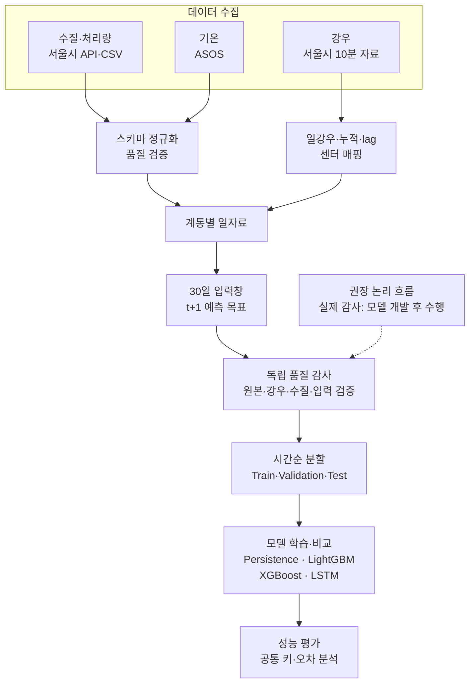

# 서울시 물재생센터 유입수질 예측

서울시 4개 물재생센터의 처리장·유입수 관측 계통을 대상으로 **과거 30일 수질·기상 정보로 다음 날 BOD·T-N·T-P를 예측**한 시계열 머신러닝 프로젝트입니다. 데이터 수집·품질 검증부터 LightGBM·XGBoost·LSTM 비교, 독립 전처리 감사와 실패 구간 분석까지 재현 가능한 파이프라인으로 구현했습니다.

> 연구·취업 포트폴리오 목적의 오프라인 예측 시스템입니다. 현재 운영 중인 실시간 서비스가 아니며, Test 구간은 개발 과정에서 반복 확인한 참고 평가입니다.

## 1. 프로젝트 소개 및 핵심 성과

- **예측 단위:** 처리장·유입수 관측 계통별 다음 날(`t+1`) BOD·T-N·T-P
- **최종 모델:** 목표별 30일 입력 기반 통합 XGBoost
- **시간 분할:** Train 2016~2022 / Validation 2023~2024 / Test 2025-01-01~2026-09-30
- **평가 구조:** 원본 11개 계통 → 학습 가능 10개 → Validation/Test 평가 가능 7개
- **품질 검증:** 수질 원본 28,828행 전수 대조, 강우 650 관측소-일 및 모델 입력 19,584개 값 독립 복원 일치
- **자동 검증:** 미래 정보 누수·계통 혼합·평가 키 중복을 포함한 테스트 107개 통과

| 목표 | 최종 입력 구성 | Validation MAE | Persistence 대비 개선 | Test MAE¹ | Test R²¹ |
|---|---|---:|---:|---:|---:|
| BOD | C/30일 + 계절·요일 | **23.2784** | **20.02%** | 22.4176 | 0.6028 |
| T-N | E/30일 + 요일 | **3.1977** | **22.05%** | 3.3942 | 0.5981 |
| T-P | C/30일 + 요일 | **0.5093** | **21.87%** | 0.5294 | 0.4027 |

¹ 전체 7개 평가 계통을 합친 통합 지표이며, 반복 확인된 Test 참고 성능입니다. 수치는 [최종 시각화 성능표](reports/final_model_visualization_metrics_2026-11-14.csv)에서 재확인했습니다.

## 2. 데이터 수집·전처리 및 파이프라인



| 자료 | 출처·서비스 | 기간·규모 |
|---|---|---|
| 유입수질 | 서울시 `ViewQowRep` 및 대조 CSV | 2016-01-01~2026-09-30, 원본 74,917행 중 유입수 28,828행 |
| 처리량 | 서울시 `ViewTreQty` 및 대조 CSV | 원본 48,771행, 정확 키 결합 18,443행 |
| 기온 | 기상청 ASOS 일자료 | 서울 108 중심, 수질 28,828행에 결합 |
| 강우 | 서울시 강우 관측망 10분 자료 | 관측 파일 944개, 38,322,021행, 관측소 69개 |

핵심 전처리 원칙은 다음과 같습니다.

- `계통구분=유입수`만 사용하고 방류수질은 목표에서 제외했습니다.
- `TP`를 분석 표기 `T-P`와 매핑하고 원래 단위(mg/L)를 보존했습니다.
- 결측·0·이상치를 임의 삭제·보간하지 않았습니다.
- 강우 누적기간에 미확인 결측이 있으면 누적값도 `NaN`으로 유지했습니다.
- 모든 lag·rolling은 계통별로 `shift`한 뒤 계산해 미래 정보를 차단했습니다.
- 처리장 구분없음은 센터 대표값으로 임의 해석하거나 다른 처리장과 평균하지 않고 독립 계통으로 유지했습니다.
- 처리량 `1차+2차`는 공식 유입유량이 아닌 검증 가설로 남겼습니다.

자세한 기준은 [데이터 품질 보고서](reports/data_quality_report.md)와 [센터·계통 통합 규칙](docs/integration_rules.md)에 정리했습니다.

## 3. 예측 모델 설계 및 학습

- **입력:** 해당 계통의 목표일 직전 30일 수질·ASOS 기온·서울시 강우 피처
- **목표:** 다음 날(`t+1`) BOD·T-N·T-P
- **분할 기준:** `target_date`
- **모델 선택:** Validation MAE만 사용
- **평가:** MAE·RMSE·R², Persistence 대비 개선율, 계통별·고농도 슬라이스
- **재현성:** 고정 시드, Train-only 전처리, 동일 평가 키 비교

동일한 B 구성(과거 수질+ASOS 기온), 30일 입력과 공통 Validation 표본에서 알고리즘을 비교했습니다.

| 목표 | Persistence | LightGBM | XGBoost | LSTM |
|---|---:|---:|---:|---:|
| BOD | 29.1064 | 23.9571 | **23.7582** | 24.6479 |
| T-N | 4.1024 | 3.3801 | **3.3528** | 3.3975 |
| T-P | 0.6519 | **0.5294** | 0.5303 | 0.5368 |

알고리즘 차이는 크지 않았지만 XGBoost가 BOD·T-N에서 가장 낮았고, 목표별 강우·달력 실험에서도 안정적이어서 최종 알고리즘으로 선택했습니다. 상세 비교는 [3종 모델 비교 보고서](reports/xgboost_lstm_comparison_report.md)를 참고하세요.

## 4. 최종 성능 및 Test 예측 그래프

대표 그래프는 7개 평가 계통의 **전체 Test 기간(2025-01-01~2026-09-30)** 성능을 MAE·R²·농도 변동성·Persistence 대비 개선율·추세 일치 정도로 비교한 뒤 선정했습니다. 세 항목 모두 난지물재생센터 처리장 구분없음이 낮은 MAE와 높은 R², Persistence 대비 양의 개선을 함께 보여 대표 사례로 선정됐습니다.

이 그래프는 성능이 양호한 개별 계통 사례이며 전체 모델의 일반적인 성능을 뜻하지 않습니다. 표의 통합 R²와 아래 개별 계통 R²를 구분해야 합니다. 일별 관측값을 평활화·보간하지 않았고 관측 공백에서는 선을 연결하지 않았습니다.

### BOD — 난지물재생센터 처리장 구분없음

Test MAE **20.8214mg/L**, R² **0.5966**, n=638, Persistence 대비 MAE **22.42% 개선**. BOD는 서남 계통의 R²가 더 높았지만 Persistence보다 MAE가 악화되어 균형 있는 대표 사례에서 제외했습니다.


### T-N — 난지물재생센터 처리장 구분없음

Test MAE **2.6237mg/L**, R² **0.7432**, n=638, Persistence 대비 MAE **23.68% 개선**.


### T-P — 난지물재생센터 처리장 구분없음

Test MAE **0.2439mg/L**, R² **0.6535**, n=638, Persistence 대비 MAE **29.63% 개선**.


Test는 모델 선택에 사용하지 않았지만 개발 과정에서 반복 확인했으므로 완전히 잠긴 독립 홀드아웃으로 해석하지 않습니다.

## 5. 모델 개선 실험 및 주요 발견

- **서울시 강우:** XGBoost Validation MAE를 BOD 1.24%, T-N 4.40%, T-P 3.31% 개선했습니다. 관측소는 공식 하수처리구역 대표가 아닌 잠정 매핑입니다.
- **계절·요일:** 계절 단독 효과는 없었지만 BOD는 계절+요일, T-N·T-P는 요일 추가 시 소폭 개선됐습니다.
- **SS:** XGBoost T-N은 0.31% 개선됐지만 BOD·T-P는 악화해 최종 공통 피처로 채택하지 않았습니다.
- **고농도 가중:** BOD 2배 가중 학습은 전체 성능 악화를 제한했으나 사전 목표인 고농도 MAE 10% 개선에는 미달했습니다.
- **실패 패턴:** Train BOD 90백분위인 180mg/L 이상을 사후 분류했을 때 Validation 고농도 MAE는 55.5447mg/L, 과소예측률은 91.80%였습니다. 특히 중랑 제2처리장의 급격한 변동이 어려웠습니다.

고농도 여부는 예측 시점에 미리 알 수 있는 정보가 아닙니다. 실패 사례 그래프와 계통별 분석은 [최종 시각화 보고서](reports/final_model_visualization_report_2026-11-14.md)와 [오차 분석 보고서](reports/error_slice_analysis_report_2026-11-13.md)에서 확인할 수 있습니다.

## 6. 데이터 신뢰성 검증

기존 전처리 함수를 호출하지 않는 별도 감사 경로로 원본과 최종 데이터셋을 대조했습니다.

| 감사 항목 | 결과 |
|---|---:|
| 원본 파일 SHA-256 기준선 | CSV 947개, 약 1.24GB |
| 강우 원시 관측자료 계보 | 38,322,021행 |
| 수질 원본-가공 전수 대조 | 28,828/28,828행 일치 |
| 강우 독립 재계산 | 650/650 관측소-일 일치 |
| 30일 모델 입력 독립 복원 | 19,584/19,584개 값 일치 |
| 계통 혼합·미래 날짜·분할 오류 | 0건 |
| 자동 테스트 | 107개 통과 |

650개 관측소-일과 128개 입력창은 고정 시드 층화 표본 감사입니다. 전체 강우 원시 행을 두 번째 구현으로 전수 재집계한 것은 아니며 원본 센서의 계측 정확도까지 보증하지 않습니다. 과거 해시가 없던 파일의 현재 SHA-256은 향후 변경 검사용 기준선이지 과거 불변의 증거가 아닙니다.

자세한 내용은 [전처리 독립 감사 보고서](reports/preprocessing_independent_audit_2026-11-14.md)를 참고하세요.

## 7. 프로젝트 한계 및 개선 방향

| 한계 | 의미와 개선 방향 |
|---|---|
| BOD·T-P 고농도 과소예측 | 평균 회귀 경향이 급등을 축소함. 위험 분류, quantile/비대칭 손실, 예측구간 검토 |
| 계통별 성능 차이 | 중랑 제2·탄천 일부 패턴을 충분히 설명하지 못함. 표본이 충분한 계통별 모델 비교 |
| 잠정 강우 관측소 매핑 | 인접 관측소가 하수처리구역 전체를 대표한다고 단정할 수 없음. GIS 기반 검증 필요 |
| 수질·기상 공개 시점 미확인 | 당일 실측 입력이 예측 발행 시각에 가용한지 미확인. 운영 전 공개 지연 계약 검증 필요 |
| 처리량 정의 미확정 | 1차·2차 합계를 실제 유입유량으로 볼 공식 근거 부족. 측정 경계·비중복성 확인 필요 |
| 반복 확인된 Test | 완전히 잠긴 최종 홀드아웃이 아님. 향후 미사용 기간 또는 rolling-origin 평가 필요 |
| 오프라인 프로젝트 | 자동 배포·모니터링·재학습·알림이 없음. 운영화 시 데이터 지연·드리프트 감시 필요 |

## 8. 실행 방법 및 프로젝트 구조

### 환경 설정

```powershell
python -m venv .venv
.venv\Scripts\Activate.ps1
python -m pip install -r requirements.txt
Copy-Item .env.example .env
```

`.env`에는 본인이 발급받은 키를 설정하며 저장소에 커밋하지 않습니다.

```dotenv
SEOUL_API_KEY=...
DATA_GO_KR_API_KEY=...
```

원본은 Git에서 제외되므로 재현 시 `data/external/`에 검증 CSV와 서울시 강우 자료가 필요합니다.

```powershell
python -m pytest -q
python scripts/collect_asos_daily.py
python scripts/process_seoul_rainfall.py
python scripts/build_training_dataset.py

# 공통 모델 단일 실험 예시
python scripts/train_xgboost_comparison.py --train-one --config C --window 30 --target bod_mg_l

# 최종 달력 피처 실험·시각화·독립 감사
python scripts/train_calendar_weighted_xgboost.py
python scripts/visualize_simplified_final_predictions.py
python scripts/run_preprocessing_audit.py
```

```text
├─ configs/                 # 관측소·수집 설정
├─ docs/                    # 설계·데이터 사전·포트폴리오 이미지
├─ reports/                 # 핵심 품질·모델·감사 결과표와 보고서
├─ scripts/                 # 수집·전처리·학습·평가 진입점
├─ src/
│  ├─ audit/                # 기존 구현과 독립된 감사 로직
│  ├─ data/                 # API, 캐시, 서울시 강우 처리
│  ├─ evaluation/           # 평가 키·시각화 검증
│  ├─ models/               # LightGBM·XGBoost·LSTM
│  └─ preprocessing/        # 스키마·결합·윈도 생성
└─ tests/                   # 누수·계통 혼합·모델·감사 회귀 테스트
```

수집·학습 결과는 `data/processed/`, `results/`에 저장되며 Git에서 제외됩니다. 저장소에는 코드, 테스트, 설정 예시, 핵심 보고서와 대표 이미지만 포함합니다. 추가 기술 문서는 [학습 데이터셋 보고서](reports/training_dataset_report.md), [최종 성능 통합 보고서](reports/final_model_integration_report_2026-11-13.md)에서 확인할 수 있습니다.
